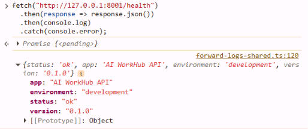
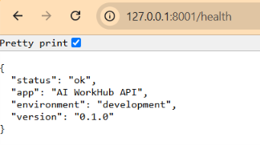
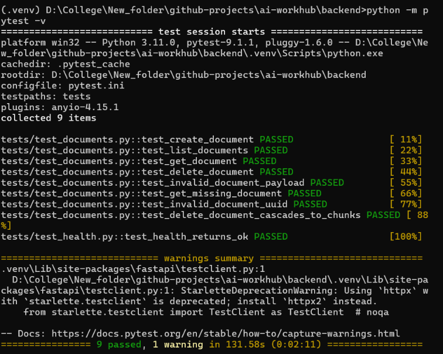

\# AI WorkHub — Intelligent Document \& Knowledge Assistant

An AI-powered document and knowledge management platform designed to help users organize documents, retrieve relevant information, and eventually ask natural-language questions over their personal knowledge base.

AI WorkHub is being developed as a full-stack portfolio project with a modern web frontend, a Python backend, and a PostgreSQL database with vector-search capabilities.

> \*\*Project status:\*\* In active development. The backend foundation, database schema, document metadata CRUD APIs, structured error handling, and initial automated tests have been implemented. Document ingestion, embeddings, semantic retrieval, and AI-powered question answering are planned next.

\## Table of Contents

\- \[Project Overview](#project-overview)

\- \[Current Features](#current-features)

\- \[Technology Stack](#technology-stack)

\- \[Architecture](#architecture)

\- \[Project Structure](#project-structure)

\- \[Getting Started](#getting-started)

\- \[API Reference](#api-reference)

\- \[Database Design](#database-design)

\- \[Testing](#testing)

\- \[Development Roadmap](#development-roadmap)

\- \[Engineering Practices](#engineering-practices)

\## Project Overview

Working with large collections of PDFs and other documents can make it difficult to find relevant information efficiently. AI WorkHub aims to address this problem by combining document management with retrieval-augmented generation (RAG).

The planned workflow is:

1\. Upload a document.

2\. Extract its text.

3\. Split the text into manageable chunks.

4\. Generate vector embeddings.

5\. Retrieve relevant passages using semantic search.

6\. Ask questions and receive answers grounded in the document collection.

The current implementation establishes the backend and database foundation required to build this workflow incrementally.

\## Current Features

\### Implemented

\- \*\*FastAPI backend:\*\* Application initialization and health endpoint.

\- \*\*PostgreSQL integration:\*\* Database connectivity through SQLAlchemy.

\- \*\*Database migrations:\*\* Alembic-managed schema versioning.

\- \*\*Document metadata management:\*\* Create, list, retrieve, and delete document records.

\- \*\*Structured validation:\*\* Pydantic request schemas and field-level validation errors.

\- \*\*Consistent error responses:\*\* Application-level errors, validation errors, and unexpected-error handling.

\- \*\*Relational integrity:\*\* Foreign-key constraints and cascading deletion of document chunks.

\- \*\*API documentation:\*\* Interactive Swagger UI generated by FastAPI.

\- \*\*Automated testing:\*\* Initial tests for health checks and document API behavior.

\- \*\*Frontend foundation:\*\* Next.js, TypeScript, and Tailwind CSS application scaffold.

\### Planned

\- Actual PDF and document uploads.

\- File storage and file-type validation.

\- Document text extraction and preprocessing.

\- Text chunking and chunk management.

\- Embedding generation and vector indexing.

\- Semantic search using pgvector.

\- Retrieval-augmented question answering.

\- Chat interface with source references.

\- Frontend-to-backend integration.

\- Containerized full-stack deployment and CI/CD.


\## Technology Stack

| Layer | Technologies |

|---|---|

| Frontend | Next.js, React, TypeScript, Tailwind CSS |

| Backend | Python, FastAPI, Pydantic |

| ORM | SQLAlchemy |

| Database | PostgreSQL |

| Vector search foundation | pgvector |

| Migrations | Alembic |

| Testing | pytest, FastAPI TestClient, HTTPX |

| Version control | Git, GitHub |

| Planned infrastructure | Docker Compose, GitHub Actions |

The infrastructure and AI technologies listed as planned should be considered future work until their end-to-end functionality is implemented and tested.

\## Architecture

The intended architecture separates the application into distinct layers.

```text

┌────────────────────────────────────┐

│       Next.js Frontend             │

│   Document UI and Knowledge Chat   │

└─────────────────┬──────────────────┘

&#x20;                 │ HTTP / JSON

&#x20;                 ▼

┌────────────────────────────────────┐

│          FastAPI Backend           │

│                                    │

│  API Routes → Services → Repositories

│                                    │

│  Pydantic Validation               │

│  Structured Error Handling         │

└─────────────────┬──────────────────┘

&#x20;                 │ SQLAlchemy

&#x20;                 ▼

┌────────────────────────────────────┐

│            PostgreSQL              │

│                                    │

│  Documents                         │

│  Document Chunks                   │

│  pgvector Extension                │

└────────────────────────────────────┘

```
The diagram represents the intended product architecture. Document ingestion, vector retrieval, and frontend integration remain future implementation work.

\## Project Structure

```text

ai-workhub/

├── backend/

│   ├── app/

│   │   ├── api/

│   │   │   ├── documents.py

│   │   │   └── health.py

│   │   ├── core/

│   │   │   ├── config.py

│   │   │   └── errors.py

│   │   ├── db/

│   │   │   ├── base.py

│   │   │   └── session.py

│   │   ├── models/

│   │   │   └── document.py

│   │   ├── repositories/

│   │   │   └── document\_repository.py

│   │   ├── schemas/

│   │   │   ├── common.py

│   │   │   └── document.py

│   │   ├── services/

│   │   │   └── document\_service.py

│   │   └── main.py

│   ├── migrations/

│   │   ├── versions/

│   │   └── env.py

│   ├── tests/

│   ├── .env.example

│   ├── alembic.ini

│   └── requirements.txt

├── frontend/

│   ├── src/

│   ├── public/

│   ├── package.json

│   └── ...

├── .gitignore

└── README.md

```
\## Getting Started
\### Prerequisites

\- Python 3.11
\- Node.js and npm
\- Docker Desktop
\- Git

\### 1. Clone the repository

```bash

git clone <YOUR\_GITHUB\_REPOSITORY\_URL>

cd ai-workhub

```
\### 2. Configure PostgreSQL

The current development environment uses PostgreSQL with pgvector.

If you are reproducing the original local development setup, configure a PostgreSQL instance with:

\- Database: `workhub`

\- User: `workhub`

\- Host port: `5434`

Do not reuse development passwords in a public deployment.

\### 3. Configure the backend

```bash

cd backend

python -m venv .venv

```
On Windows CMD:
```cmd

.venv\\Scripts\\activate

python -m pip install -r requirements.txt

```
Create a local `.env` file using `.env.example` as a reference. Set `DATABASE\_URL` to match your PostgreSQL credentials and port.

\### 4. Apply database migrations

From the backend directory:

```cmd

alembic upgrade head

```
\### 5. Start the backend

```cmd

uvicorn app.main:app --reload --host 127.0.0.1 --port 8001

```
API base URL:

`http://127.0.0.1:8001`

Interactive API documentation:

`http://127.0.0.1:8001/docs`

Health endpoint:

`http://127.0.0.1:8001/health`

\### 6. Start the frontend

Open another terminal:

```cmd

cd frontend

npm install

npm run dev

```
Open `http://localhost:3000`.

The frontend scaffold is available, but complete integration with the document API is still in development.

\## API Reference

| Method | Endpoint | Description |

|---|---|---|

| GET | `/health` | Application health check |

| POST | `/api/documents` | Create a document metadata record |

| GET | `/api/documents` | List documents with pagination |

| GET | `/api/documents/{document\_id}` | Retrieve a document |

| DELETE | `/api/documents/{document\_id}` | Delete a document |

\### Example: Create a document record

```http

POST /api/documents

Content-Type: application/json

```
```json

{

&#x20; "filename": "sample.pdf",

&#x20; "content\_type": "application/pdf",

&#x20; "file\_size": 1024,

&#x20; "stored\_path": "uploads/sample.pdf"

}

```
A successful request returns `201 Created` and a document identifier.

\*\*Current limitation:\*\* This endpoint creates a metadata record only. Actual file upload and storage have not yet been implemented.

\### Error handling

The API provides structured errors for cases such as:

\- Invalid request data: `422 Unprocessable Entity`

\- Missing document: `404 Not Found`

\- Unexpected server errors: `500 Internal Server Error`

\## Database Design

\### Documents

Stores document metadata, including:

\- UUID primary key

\- Filename and content type

\- File size and internal storage path

\- Processing status

\- Creation and update timestamps

Supported processing statuses:

\- `uploaded`

\- `processing`

\- `ready`

\- `failed`

\### Document Chunks

Stores text chunks associated with documents, including:

\- UUID primary key

\- Parent document identifier

\- Chunk index

\- Text content

\- Creation timestamp

The schema includes a unique constraint on `(document\_id, chunk\_index)` and a foreign key with `ON DELETE CASCADE`.

The vector-search foundation is available through pgvector; embedding storage and retrieval are planned for a subsequent phase.

\## Testing

The backend uses pytest and FastAPI's TestClient.
Run the tests from the backend directory:

```cmd

python -m pytest -v

```
The tests cover health checks and document API behavior, including creation, listing, retrieval, deletion, and validation errors.
Automated tests should run against a dedicated test database rather than a production database.

\## Development Roadmap

\- \[x] Initialize frontend and backend foundations

\- \[x] Configure PostgreSQL and pgvector

\- \[x] Implement SQLAlchemy models and Alembic migrations

\- \[x] Implement document metadata CRUD endpoints

\- \[x] Add structured API error handling

\- \[x] Add initial automated tests

\- \[ ] Finalize isolated test database configuration

\- \[ ] Implement actual document uploads

\- \[ ] Add text extraction and chunking

\- \[ ] Generate and store embeddings

\- \[ ] Implement semantic retrieval

\- \[ ] Add RAG-based question answering

\- \[ ] Integrate the frontend with the backend

\- \[ ] Add CI/CD and deployment configuration

\- \[ ] Publish end-to-end demo screenshots

\## Engineering Practices

The project is being developed with an emphasis on:

\- Separation of API, service, repository, and database layers

\- Request validation and consistent error responses

\- Version-controlled database migrations

\- Environment-based configuration

\- Automated testing

\- Incremental implementation and documented future work

\## License

A license has not yet been selected. Until one is added, all rights are reserved by the project owner.

## Screenshots

### API Overview



### Health Check



### Automated Tests


